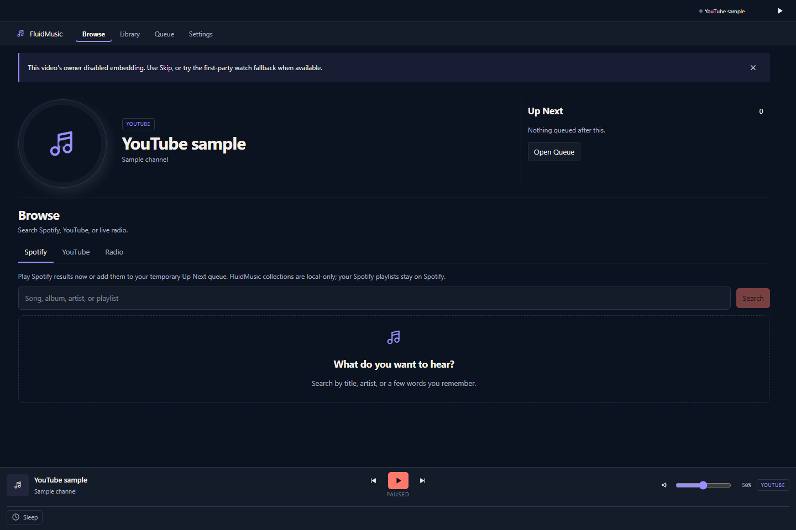
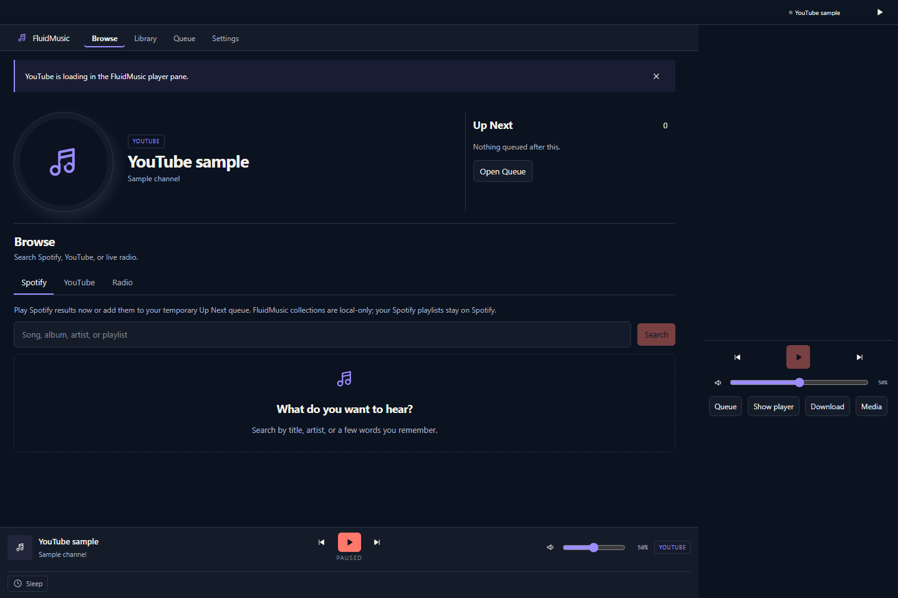
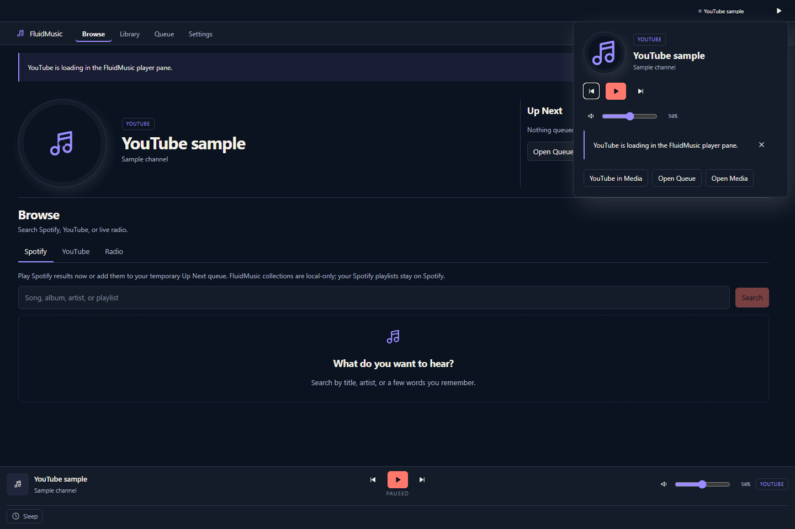
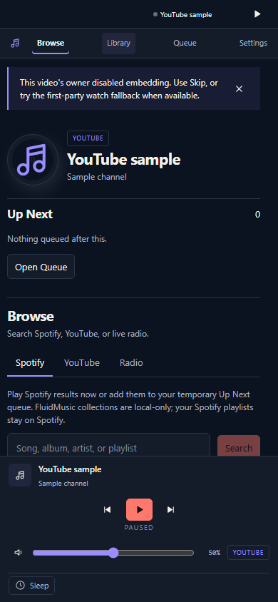

# FluidMusic

[](https://github.com/noxius-studium/fluid-music/actions/workflows/ci.yml)
[](https://github.com/noxius-studium/fluid-music/releases)
[](LICENSE)

**Spotify Connect, YouTube, internet radio, and your local library in one Hermes Desktop player.**

[Releases](https://github.com/noxius-studium/fluid-music/releases) · [Architecture](docs/architecture.md) · [Limitations](docs/limitations.md) · [Spotify setup](docs/spotify-setup.md) · [Contributing](CONTRIBUTING.md)



FluidMusic keeps one application-level queue and one shared set of controls without pretending every provider uses the same playback engine. Spotify plays on a Connect device. Radio, local files, and indexed downloads play inside Hermes. YouTube stays in the FluidMusic player.

## Screenshots

| YouTube download and compact player                                                        | Titlebar quick controls                                                           |
| ------------------------------------------------------------------------------------------ | --------------------------------------------------------------------------------- |
|  |  |

<p align="center">
  
</p>

The screenshots use labelled sample data. Provider artwork and catalog content load at runtime.

## What it provides

- A Night Radio Media workspace with a circular artwork/record focal object and compact Browse, Library, Queue, and Settings navigation.
- One persistent application controller, a titlebar quick-control popover, and an optional dockable mini-player. Route and chat-focus changes do not own or reset playback.
- YouTube search and watch-URL entry with real titles, played inside the FluidMusic player through a capability-protected loopback embed host; an optional first-party watch fallback is offered only when the host actually provides the owned-view capability.
- Audio-only YouTube downloads on result rows and in the compact player. Downloads go into the selected approved local root, are indexed, and join Up Next without interrupting playback.
- One restart-restorable application queue across Spotify, radio, indexed local tracks, and safe YouTube entries. Session-opened files are intentionally omitted at restart.
- Local-only FluidMusic collections with edit/reorder/export workflows. Existing v3 mixed playlists remain visible as read-only Legacy mixes with play, enqueue, and export.
- Spotify search for songs, albums, artists, and playlists, plus the user's Spotify playlists and track details.
- Expandable Spotify playlists in the queue with exact song selection, including duplicate occurrences.

- Radio Browser discovery and direct internal radio playback.
- A profile-scoped SQLite local-library catalog with approved scan roots, stable track IDs, availability tracking, rescans, and move recovery.
- Theme-native SVG icons and Hermes theme variables throughout the FluidMusic chrome.

## Provider behavior

| Provider       | Where playback happens                                                    | Important boundary                                                                                                                                                     |
| -------------- | ------------------------------------------------------------------------- | ---------------------------------------------------------------------------------------------------------------------------------------------------------------------- |
| Spotify        | On the selected Spotify Connect device                                    | FluidMusic sends remote-control commands; it does not decode Spotify audio.                                                                                            |
| Internet radio | Inside Hermes through browser audio                                       | Stream availability, codecs, CORS, advertising, and station content remain controlled by the station.                                                                  |
| Local music    | Inside Hermes through the seekable `hermes-media` protocol                | Only explicitly approved folders are scanned. Audio bytes remain on disk.                                                                                              |
| YouTube        | Inside the FluidMusic player pane via the capability-protected embed host | Embedding restrictions remain the provider's. Explicit audio downloads are personal-use tools and never bypass DRM, ads, authentication, paid access, or entitlements. |

FluidMusic does not remove ads, bypass DRM, unlock Premium features, or override provider content restrictions.

## Production installation

Use a tagged release or a full verified commit SHA on production machines. Avoid a floating branch when you expect the install to remain stable.

```powershell
hermes plugins install https://github.com/noxius-studium/fluid-music.git `
  --ref <full-40-character-commit-sha> `
  --yes-deps `
  --enable
```

Verify the installed package:

```powershell
hermes plugins show fluid-music
hermes plugins doctor fluid-music
```

When an update changes the Python backend, run `hermes gateway restart` from a separate terminal so the gateway loads the new API module. Hermes manages the unified package's Desktop contribution; do not install a second standalone copy under `desktop-plugins`.

You may also download a versioned ZIP from [Releases](https://github.com/noxius-studium/fluid-music/releases) and extract its `fluid-music` folder into the active profile's `plugins` directory.

The release archive contains one unified Hermes plugin folder:

```text
$HERMES_HOME/plugins/fluid-music/
├── plugin.yaml
├── pyproject.toml
├── dashboard/
│   ├── manifest.json
│   ├── plugin_api.py
│   ├── local_library.py
│   └── providers/
└── desktop/
    └── plugin.js
```

`$HERMES_HOME` is profile-specific. Install the package in the profile that runs Hermes Desktop, enable **FluidMusic** under **Settings → Plugins**, then reload desktop plugins (restart Hermes Desktop only if your host requires it). A Linux/cloud development workspace is provenance for building and verifying the artifact — it is not the Desktop install location, and cloud paths never appear in runtime instructions.

## Spotify setup

FluidMusic owns a separate Spotify PKCE connection. An existing `hermes spotify` login can supply the public Client ID, but it does not authenticate FluidMusic or share refresh-token ownership.

1. Open the [Spotify Developer Dashboard](https://developer.spotify.com/dashboard), create or edit your app, and register this exact redirect URI:

   ```text
   http://127.0.0.1:41337/spotify/callback
   ```

2. Open **Media → Settings → Providers**.
3. Enter your public Spotify Client ID if it is not already filled in. Never enter a client secret.
4. Select **Connect Spotify** and approve the request in your normal browser.
5. Open Spotify on a phone, computer, speaker, or browser under the same account.
6. Return to FluidMusic, refresh devices, and select a Spotify Connect device.

Spotify Premium is required for remote playback control. A connected account with zero available devices can still browse its library; playback waits for a Connect device. See [docs/spotify-setup.md](docs/spotify-setup.md) for troubleshooting and storage details.

## Local library and download folder

Open **Media → Library → Local → Music folders** and choose a folder. Browser-hosted or remote views can enter an absolute path on the backend host instead.

The selected folder becomes both a recursively scanned library root and the destination for user-requested YouTube audio downloads. When several roots are configured, select **Use for fallback** on the folder that should receive downloads.

The backend stores its catalog at:

```text
$HERMES_HOME/plugin-data/fluid-music/library.sqlite3
```

SQLite stores:

- approved scan-root paths;
- stable local-track IDs;
- canonical and relative paths;
- title, MIME type, size, modification time, and a bounded content fingerprint;
- availability and scan timestamps.

SQLite never stores audio bytes, OAuth credentials, browser object URLs, passwords, or provider tokens.

A rescan recursively indexes MP3, FLAC, M4A, AAC, WAV, Ogg, Opus, and WebM audio. If a file disappears, its catalog entry and playlist reference remain but are shown as unavailable. If the same file moves within an approved root, its bounded fingerprint allows FluidMusic to retain the stable track ID when the move is unambiguous.

Removing a scan root removes that root and its catalog rows. FluidMusic playlist references remain stable metadata; affected local entries become unavailable until the track is indexed again.

## Direct session files

Use **Media → Library → Local → Open audio files** to play a file without indexing its folder. Opened files are session-only: select them again after restarting Hermes. They cannot be saved to persistent collections.

FluidMusic no longer includes a visualizer or analyser settings. This does not change radio or local audio playback.

## Collection ownership

New FluidMusic collections are local-only and store local-track IDs resolved through the SQLite catalog. Spotify playlists remain provider-owned live contexts, radio persistence is pinned stations, and Up Next is the temporary/restart-restorable cross-source list. Existing mixed v3 playlists are preserved without rewriting as read-only **Legacy mixes**.

The persisted local entry contains only the stable local-track ID and display metadata—not a raw filesystem path or media URL. At startup, FluidMusic resolves that ID against the active profile's SQLite catalog before playback.

## Browse, YouTube, and local downloads

The **Browse** workspace combines Spotify search, radio discovery, and YouTube search or watch-URL entry. YouTube results play inside the FluidMusic player through a 127.0.0.1-only capability host with strict Host/origin checks and the official command relay.

For YouTube items only, **Download** appears on result rows and in the compact player beside **Show player**. FluidMusic asks `yt-dlp` for audio only, prefers a native M4A stream, saves it in the selected approved local root, rescans the folder, and adds the indexed track to Local Music and Up Next. A download never stops or retargets the active player.

### Personal-use and use-at-your-own-risk notice

The YouTube download feature is provided for personal use only. You are solely responsible for confirming that you have the right or permission to download, store, copy, or use content and for complying with YouTube's terms, copyright rules, and all laws that apply to you.

The project authors, maintainers, contributors, and distributors do not endorse copyright infringement or misuse of provider services. To the maximum extent permitted by law, they accept no responsibility or liability for what a user downloads, how downloaded media is used or shared, account restrictions or bans, provider action, data loss, legal claims, or other damage arising from the download feature. **Use it entirely at your own risk.**

FluidMusic does not provide legal advice and does not bypass DRM, paid access, ads, authentication, entitlements, or technical protection measures. If you are unsure whether you may download something, do not download it.

When a video refuses embedding but works on the normal watch page, FluidMusic offers the first-party watch fallback only when the host exposes the verified owned-view capability. Otherwise it reports the missing contract and offers Retry or Skip. Exactly one playback engine is active at a time.

## Listening sessions, resume and recovery (0.5.0)

- **Queue editing:** Play next, Add to end, multi-select remove/move, clear-upcoming vs clear-all (both confirmed), one-step undo, and "Added from search/history/collection/provider/library" provenance captions. Queue actions never edit provider-owned playlists.
- **Listening sessions:** named snapshots of safe source references. Restore previews unavailable items and asks Replace/Append inside the dialog; nothing autoplays.
- **Resume and bookmarks:** eligible long-form YouTube/local items (10 minutes or longer) offer explicit Resume/Start over and timestamp bookmarks. LIVE radio is never treated as seekable.
- **History discovery:** title/source/date filters, stable pagination, per-entry removal, scoped clear, and an explicit retention preference (Settings → Playback).
- **Sleep timer:** 15/30/60 minutes, custom 1–720, or end-of-item where supported; remaining time and Cancel live in the shared player. Changing the source cancels the timer — it never takes over another device later.
- **Recovery center:** Settings → Recovery shows evidence-based source health with bounded Retry/Skip/Reconnect/Rescan and sanitized copy-diagnostics. Retries cool down after three attempts; there is no fake all-online badge.
- **Host compatibility:** the declared contract and optional-door fallbacks live in [docs/handoffs/agent-plan/COMPATIBILITY.md](docs/handoffs/agent-plan/COMPATIBILITY.md). Unknown future breaking Hermes releases are not guaranteed; an incompatible host gets a precise recovery surface and saved data is never deleted.

## Queue and controls

The queue preserves provider order, but controls remain capability-driven:

- Spotify exposes Connect transport, seek, volume, and device state where accepted by Spotify.
- Local playback exposes seek, volume, previous, and next.
- Radio exposes play/pause and volume, not fake seeking or station-content skipping. Select another queue item to switch sources.
- YouTube exposes play/pause, seek, volume, previous, and next for the selected item through the embed host's official relay (or the capability-gated first-party watch surface).

By default, completing a Spotify track advances to the next FluidMusic queue item. The **Let Spotify continue after a track** setting instead leaves continuation to Spotify's active context or recommendations. Spotify progress is interpolated locally between authoritative snapshots, so the visible elapsed and remaining time advance smoothly without polling Spotify every second.

## Development and verification

The desktop implementation is maintained as nine focused source fragments:

- `desktop/src/00-runtime.js` — Hermes/React imports and constants
- `desktop/src/10-model.js` — queue models, validation, and pure provider payloads
- `desktop/src/20-styles.js` — theme-aware styling and shared UI primitives
- `desktop/src/30-controller.js` — provider adapters, transitions, polling, and diagnostics
- `desktop/src/40-ui.js` — shared rows, local-only save dialogs, volume, seek, and transport primitives
- `desktop/src/41-library.js` — overview, Spotify catalog/library, radio, and local folders
- `desktop/src/42-playlists.js` — playlist editor, bulk picker, import/export, and queue page
- `desktop/src/43-visualizer.js` — optional dockable mini-player pane (the filename is retained for build ordering; there is no visualizer or footer player)
- `desktop/src/44-workspace.js` — compact navigation, settings/diagnostics, titlebar control, and registration

Hermes loads disk contributions through a blob URL, so relative browser imports are not reliable. `desktop/plugin.js` is the generated runtime entrypoint. Edit the fragments, then rebuild it:

```bash
python scripts/build_desktop.py
python scripts/build_desktop.py --check
```

The **Settings → Diagnostics** view records sanitized provider commands, response status, selected device suffixes, failures, and meaningful Spotify playback-state changes. It never stores OAuth credentials or tokens.

Full verification:

```bash
python scripts/build_desktop.py
python scripts/build_desktop.py --check
node --check desktop/plugin.js
node --test tests/*.test.mjs
python -m pytest -q
npm run test:ui
python scripts/package.py
```

The renderer tests exercise the generated bundle, while backend tests use isolated temporary SQLite databases and labelled provider doubles. `npm run test:ui` renders wide and narrow layouts in Chromium, checks keyboard focus and WCAG rules, and refreshes the tracked README screenshots.

Fixtures cannot prove real sound, live provider availability, a Spotify account/device, or YouTube availability on a packaged machine. Release acceptance still includes a live Hermes Desktop pass.

## License

FluidMusic is licensed under the [Attribution-NonCommercial 4.0 International license](LICENSE). The license governs this project's source and distribution; it does not grant rights to provider media. You remain responsible for every service and media item you choose to access or download.
